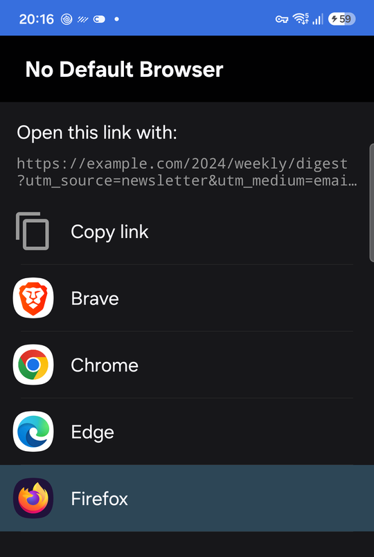

# No Default Browser

Pick a browser for every link on Android, so you never need a default browser.



Tap a link in any app → choose **No Default Browser** → pick the browser that should open it, or
copy the link instead. Choose *Always* once and this app becomes the entry point for every link.

The pick is remembered per domain (SharedPreferences, domain → package). Next time a link from
that domain shows up, the browser you chose before is highlighted in the list. Links whose domain
can't be extracted are simply not remembered.

The share sheet works too: share any text with a link in it and the app picks the URL out of it,
then behaves exactly like the tap-a-link flow (highlighted favourite, Copy link and all).

## Build and install

```bash
./build.sh
```

Requires nothing but Docker. The result is `apk/no-default-browser.apk`, signed, so it installs
with `adb install -r` or by copying it to the phone and opening it there.

The signing key is created on the first build in `.secrets/` — keep it, because without it an
update means uninstalling first.

## Wireless install, Docker only (no adb on the host)

Build a throwaway adb image once:

```bash
docker build -t adb-image - <<'EOF'
FROM ubuntu:jammy
RUN apt-get update \
 && apt-get install -y --no-install-recommends ca-certificates curl unzip \
 && rm -rf /var/lib/apt/lists/* \
 && curl -fsSL https://dl.google.com/android/repository/platform-tools-latest-linux.zip -o /tmp/pt.zip \
 && unzip -q /tmp/pt.zip -d /opt && rm /tmp/pt.zip
ENV PATH=/opt/platform-tools:$PATH
EOF
```

On the phone: Settings → Developer options → Wireless debugging → *Pair device with pairing code*.
That dialog shows an `ip:port` and a 6-digit code — pair with those (keep the dialog open):

```bash
docker run --rm --net=host -e HOME=/adbhome -v "$PWD/.secrets/adb-home:/adbhome" adb-image \
  adb pair <ip>:<pair-port> <code>
```

The pairing key lands in `.secrets/adb-home` — keep it and you never pair again. Then install using
the `ip:port` shown on the *main* Wireless debugging screen (a different port, changes whenever you
leave the screen):

```bash
docker run --rm --net=host -e HOME=/adbhome -v "$PWD/.secrets/adb-home:/adbhome" -v "$PWD/apk:/apk:ro" adb-image \
  sh -c 'adb connect <ip>:<connect-port> && adb install -r /apk/no-default-browser.apk'
```

`--net=host` lets adb reach the phone (and find it via mDNS on the LAN — not over Tailscale, there
you have to read the port off the screen). Wireless debugging sleeps after ~10 minutes and resets
on reboot, so a stale port just means: reopen the screen, copy the new one.

## How it works

- Registers for `http` and `https` links and lists every app that can render a web page.
- Hands the link to the app you tap with `setPackage()`, so it cannot bounce back to a default.
- Browsers declare their web filters in two flavours (scheme only, or scheme + `text/html`), and
  which one they use depends on Android and browser version, so the app probes both.
- No dependencies at all: a handful of Java files against the framework, built by six command line tools
  (`aapt2`, `javac`, `d8`, `zip`, `zipalign`, `apksigner`) in a Docker image. 21 KB APK.

## Requirements

Android 7.0 or newer, and at least one browser installed.

## License

MIT
